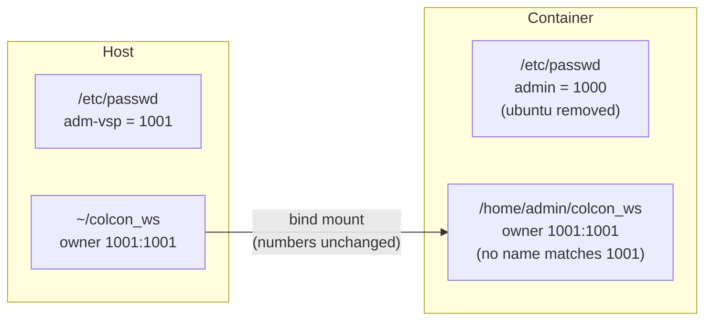
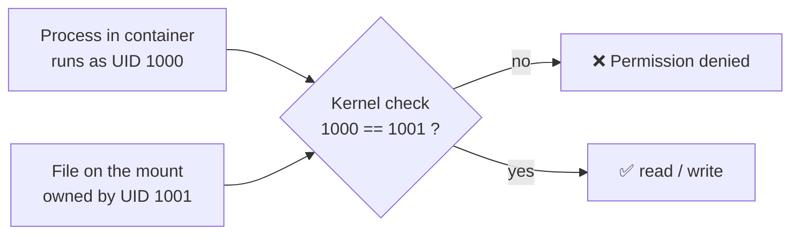
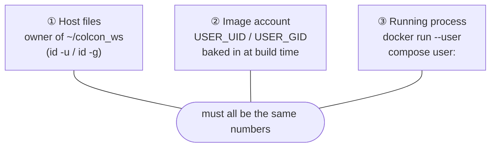
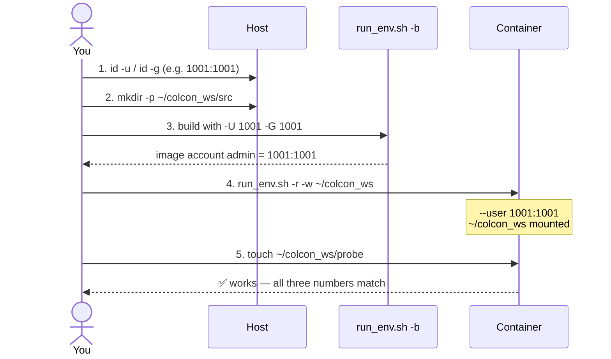
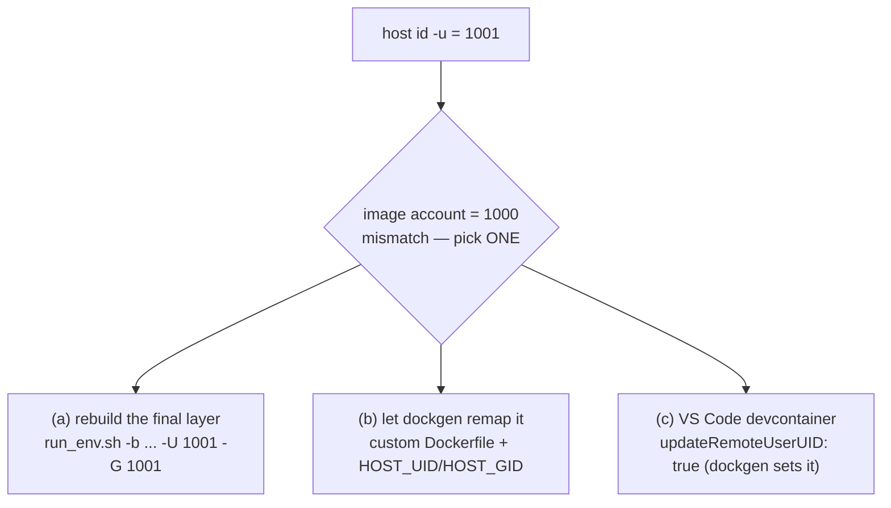
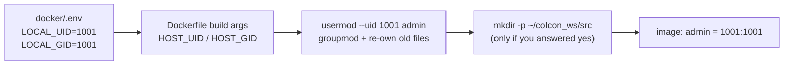
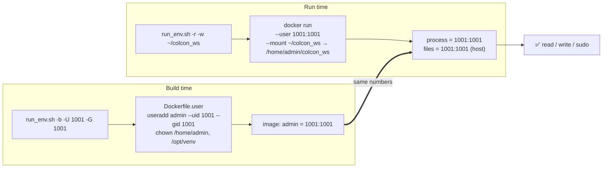

# UID / GID: why files become "Permission denied" and how to fix it

This guide explains, step by step, how user IDs work between your host and a
docker_envs container, and which knob to turn in each situation. Read the
first three sections once; after that the [decision table](#which-fix-do-i-need)
is all you need.

**Videos** (if you prefer watching first):

- [Running Docker Containers as a Non-root User with a Custom UID / GID](https://www.youtube.com/watch?v=sXfaogNlc7Y) — the exact problem this guide solves.
- [Users, groups, and identity: UID, GID, EUID, EGID explained simply](https://www.youtube.com/watch?v=RC2AxEt5Bls) — Linux background, no Docker.

---

## 1. The one rule: the kernel only sees numbers

A Linux file does not store *who* owns it by name. It stores two numbers:

```
$ ls -ln ~/colcon_ws
drwxr-xr-x 3  1001 1001  4096 Oct 13 09:00 src
              ^^^^ ^^^^
              UID  GID      <- this is all the kernel stores
```

- **UID** (user ID) — the number of the owning user.
- **GID** (group ID) — the number of the owning group.
- Names like `adm-vsp` or `admin` are only labels looked up in `/etc/passwd`
  and `/etc/group`.

Check your own numbers on the host:

```bash
id            # uid=1001(adm-vsp) gid=1001(adm-vsp) groups=1001(adm-vsp),27(sudo),...
id -u         # 1001
id -g         # 1001
```

## 2. A container has its own name list, but shares the numbers

The container has a **different** `/etc/passwd`, but the **same kernel**. A bind
mount shows the host's files *as they are*, numbers included:



The kernel compares numbers only:



Nothing is "translated" between host and container (unless you use user
namespaces / rootless Docker, which docker_envs does not assume).

## 3. The three numbers that must agree



- ① is decided by whoever created the folder on the host — you.
- ② is decided when the image is built (`-U` / `-G` in `run_env.sh -b`, or
  dockgen's `HOST_UID` / `HOST_GID` build args).
- ③ is decided when the container starts (`run_env.sh` always passes
  `--user <uid>:<gid>`).

If ③ matches ① you can write your files. If ② also matches, the process has a
proper name, a home it owns (`~/.cache`, `~/.local`, `/opt/venv`) and `sudo`.

## 4. Step by step: the normal workflow



### Step 1 — Find your IDs

```bash
id -u   # e.g. 1001
id -g   # e.g. 1001
```

### Step 2 — Create the workspace on the host, as yourself

```bash
mkdir -p ~/colcon_ws/src
ls -ldn ~/colcon_ws          # must show your id -u / id -g
```

Never let Docker create it: a missing bind-mount source is created as
`root:root` and you will need `sudo` to fix it.

### Step 3 — Build the image with the same IDs

`run_env.sh -b` defaults `-U` / `-G` to your current `id -u` / `id -g`, so the
plain build is already correct:

```bash
creator/scripts/run_env.sh -b -o 24.04 -v jazzy          # uses id -u / id -g
creator/scripts/run_env.sh -b -o 24.04 -v jazzy -U 1001 -G 1001   # explicit
```

The final layer (`creator/common/Dockerfile.user`) creates the account
(`admin` by default) with those numbers and gives it its home, `/opt/venv`
and passwordless `sudo`. It does **not** create `~/colcon_ws` — the workspace
is yours to mount (step 4) or to add in a derived image (see
[dockgen](#dockgen-and-pre-built-images)).

### Step 4 — Run with the same IDs and mount the workspace

```bash
creator/scripts/run_env.sh -r -i docker_envs:24.04-jazzy -w ~/colcon_ws
```

`run_env.sh` mounts the folder at `/home/admin/colcon_ws` and starts the
process as `--user $(id -u):$(id -g)`.

### Step 5 — Verify inside the container

```bash
id                                   # uid=1001(admin) gid=1001(admin)
stat -c '%u:%g %n' ~/colcon_ws       # 1001:1001 /home/admin/colcon_ws
touch ~/colcon_ws/probe && rm ~/colcon_ws/probe   # no error = done
```

The login banner prints the same `UID · GID` line every time you open a shell.

## 5. Pre-built images (ghcr.io) and other machines

Published images are built with UID/GID **1000**. If your host account is
1000 (the first user on most Ubuntu installs) everything just works. If not:



### dockgen and pre-built images

With a **custom Dockerfile**, dockgen writes `docker/.env` with
`LOCAL_UID` / `LOCAL_GID` taken from the machine that ran it, and the
Dockerfile remaps the existing account:



Right after you pick the account, the wizard asks
**"Create a colcon workspace inside /home/admin (if not already there)?"**.
Answer yes and the Dockerfile runs `mkdir -p ~/colcon_ws/src` *as the
account*, so the folder is owned by the remapped IDs. Moving the project to a
machine with a different UID? Re-run `dockgen` there (or edit `docker/.env`)
and rebuild.

## 6. Which fix do I need?

| Symptom | Cause | Fix |
| --- | --- | --- |
| `Permission denied` writing in the mounted workspace | ③ ≠ ① | Run with your IDs: `run_env.sh` (default), or `--user "$(id -u):$(id -g)"`, or compose `user: "${LOCAL_UID}:${LOCAL_GID}"` |
| Files created in the container are owned by `root` on the host | Shell runs as root (③ = 0) | Same as above; the login banner warns when you are root |
| Prompt shows `I have no name!` | ③ has no entry in the image's `/etc/passwd` (② ≠ ③) | Rebuild with `-U`/`-G`, or use a dockgen custom Dockerfile |
| `pip install` / `uv` fails in `/opt/venv` or `~/.cache` | ② ≠ ③: the process is not the image account | Rebuild the final layer with your IDs |
| Workspace folder on the host is `root:root` | Docker created a missing mount source | `sudo chown -R "$(id -u):$(id -g)" ~/colcon_ws`, then always `mkdir` it first |
| `colcon build` cannot create `build/` when only `~/colcon_ws/src` is mounted | Docker created the parent `~/colcon_ws` as root | The entrypoint reclaims it automatically (image built after this change); otherwise `sudo chown "$(id -u):$(id -g)" ~/colcon_ws` inside the container |
| Teammate in another group can't write | Group bits / umask | Shared GID with `-a <gid>` and `-M 0002` (see creator guide, *Permissions*) |
| `UID 1001 is already assigned to …` during build | That number is taken in the base image | Choose another `-n` user or free the ID in your own base image |

## 7. Mental model in one picture



## Glossary

- **UID / GID** — numeric user / group IDs; the only thing the kernel checks.
- **Bind mount** — a host folder shown inside the container, with host
  ownership unchanged.
- **Named volume** — Docker-managed storage. When empty, it copies the
  ownership of the image folder it is mounted over (or is `root` if that
  folder does not exist in the image).
- **umask** — which permission bits new files *lose*. `0022` → others can
  read; `0002` → group can write too (`-M 0002` / `WORKSPACE_UMASK`).
